<div align="center">


# ASCII wallpapers

**Live wallpapers for the Claude desktop app, built from block characters.**

Eight scenes behind your chat. Each one is a single SVG: no images, no script, just characters and CSS.

       

</div>

## In the app


<sub>An illustration, not a screenshot: the wallpaper and the picker thumbnails are the mod's real output, and the app around them is drawn. The wallpaper fills the whole window, the sidebar is tinted over it, and the picker sits above the prompt.</sub>

## Install

At the prompt of a terminal session:

```
/plugin install ascii-wallpapers --marketplace jonrusso/claude-ascii-wallpapers
```

From a shell:

```
claude plugin install ascii-wallpapers --marketplace jonrusso/claude-ascii-wallpapers
```

In the desktop app, where `/plugin` does not run: click + next to the prompt box, then Plugins, Add marketplace with `jonrusso/claude-ascii-wallpapers`, then Add plugin.

Sessions that are already open pick the mod up after a restart.

## The eight

Everything below is the real wallpaper, moving. Subjects sit at the edges and the middle stays calm, because that is where you read.

<table>
  <tr>
    <td width="50%"><br><b>Coffee Farm Night</b><br><sub>warm brown dusk · <code>/wallpaper farm</code></sub></td>
    <td width="50%"><br><b>Render Farm</b><br><sub>midnight blue · <code>/wallpaper render</code></sub></td>
  </tr>
  <tr>
    <td><br><b>Keyframes</b><br><sub>deep plum · <code>/wallpaper keys</code></sub></td>
    <td><br><b>Particle Drift</b><br><sub>indigo · <code>/wallpaper drift</code></sub></td>
  </tr>
  <tr>
    <td><br><b>Deep Sea</b><br><sub>dark teal · <code>/wallpaper sea</code></sub></td>
    <td><br><b>Rain on Glass</b><br><sub>wet blue night · <code>/wallpaper rain</code></sub></td>
  </tr>
  <tr>
    <td><br><b>Starfield</b><br><sub>midnight · <code>/wallpaper stars</code></sub></td>
    <td><br><b>Just Create.</b><br><sub>plum-magenta · <code>/wallpaper create</code></sub></td>
  </tr>
</table>

## Use

| | |
| --- | --- |
| **Picker** | A row of live thumbnails above the prompt. The arrows slide the row; the chosen one carries a check. |
| **Keyboard** | `/wallpaper <name>` switches. With no name it lists them. |
| **Off** | `/wallpaper off` removes the wallpaper and keeps the colors. |
| **Memory** | Your last choice comes back in the next session. |
| **Check** | `/wallpaper test` paints a plain hot-pink ground, to see whether the app shows a backdrop at all. |

## How it is made

- **Two cells to the pixel.** A character cell is twice as tall as it is wide, so each pixel of a sprite is two block characters side by side.
- **Shimmer.** Every subject is drawn twice with a different mix of `█` and `▓`, and the two swap in place.
- **Slow on purpose.** All motion is stepped CSS, under about 12 frames a second, and it stops under the system's reduced-motion setting.
- **Any window.** In a narrow window the sides of a scene are cropped, so the subjects step inward.
- **One sprite, one line.** A subject is a few rows of text: `a` is body, `b` is highlight. Adding a scene is a mood, a cast and their places.

```js
const DROP = [
  ['..aa..', '..aa..', '.aaaa.', '.abaa.', 'aabaaa', 'aaaaaa', 'aaaaaa', '.aaaa.'],
]
```

## Notes

- Wallpapers draw in the desktop and mobile apps. A terminal shows the picker as names only.
- The mod also sets a dark palette (near-black, purple accent).
- The art uses JetBrains Mono when it is installed and falls back to another monospace font.
